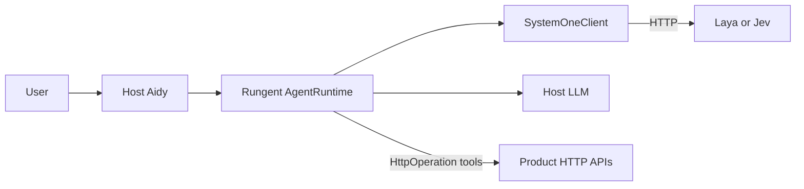
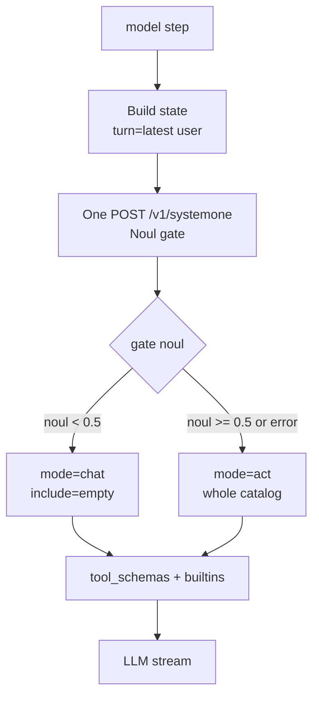
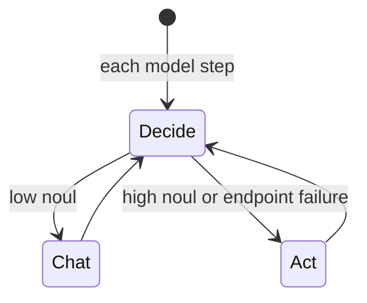

# System One (Jev-compatible)

Rungent asks a System One endpoint each model step
(TypeSafe [Jev](https://thejevai.com/docs) wire protocol; production typically uses in-cluster
**Laya**) whether the turn needs tools. Noul is that gate. The catalog itself is every `x-aidy`
operation. The caller's token decides whether a call succeeds.

Hosts plug in with `SystemOneSettings.from_env()` only — no product-specific shortlist code in the
library, and no System One policy modules in the host.

## Role

- **Does:** decide chat vs tools. When tools are needed, the model sees the whole catalog.
- **Does not:** fill arguments, write prose, replace `approval="always"`, or enforce RBAC.

## Contract (one evaluate per step)

```text
state = { turn: <latest user text> }
questions = {
  needs_tool / acts_on_resources / prose_suffices: product-neutral Nouls,
}
gate = max(needs_tool, acts_on_resources, 1 - prose_suffices)
```

| Condition | Mode | `include` (business tools) |
| --- | --- | --- |
| `gate < threshold` (default 0.5) | `chat` | empty — builtins only |
| gate ≥ threshold, or the endpoint fails | `act` | the whole catalog |

A catalog tool the user cannot call fails at the API. Write and delete tools keep their own confirmation.

Builtins (`request_input`, `report_progress`) are always attached by `Agent.tool_schemas`.

`family` and `domain` on `x-aidy` still describe a workflow and a product area. They are metadata for hosts and for confirmation grouping. They do not decide which tools the model is allowed to see.

## Configure

```python
from rungent import SystemOneSettings, create_openapi_runtime

runtime = create_openapi_runtime(
    ...,
    systemone=SystemOneSettings.from_env(),  # SYSTEMONE_BASE_URL required
)
```

| Env | Default | Meaning |
| --- | --- | --- |
| `SYSTEMONE_BASE_URL` | (required) | Laya / Jev base; trailing `/v1` stripped |
| `SYSTEMONE_MODEL` | `multilingual` | Decision model id |
| `SYSTEMONE_API_KEY` | — | Bearer for the endpoint |
| `SYSTEMONE_TIMEOUT_SECONDS` | `5` | HTTP timeout |
| `SYSTEMONE_NEEDS_TOOL_THRESHOLD` | `0.5` | Below → `chat` |

Logs each step: `mode`, `noul`, `include_size`.

## OpenAPI tool source

Hosts pass service roots via `OpenApiHost` / `load_operations_from_hosts` /
`replace_openapi_tools`. Rungent resolves `{base_url}/openapi.json` (or uses
in-proc `spec=`). Catalog = operations marked `x-aidy`. Tool **execution** still
uses the host loopback base URL.

## Diagrams

### Components



### Per model step



### Modes



## Security

Pass the latest user text as `state.turn`. Do not concatenate
untrusted tool output into question instructions. Keep permissions, path allowlists, and spend
caps in host code — System One advises; the runtime enforces.

## Anti-patterns

- Hiding a catalog tool because a nearby read won a choice. The user's token is the permission check.
- Freezing `state.turn` to the original `run.input` instead of the latest user message.
- Treating empty business `include` as a bug; `chat` mode intentionally exposes builtins only.
- Baking product language or draft name regexes into the library harness.
